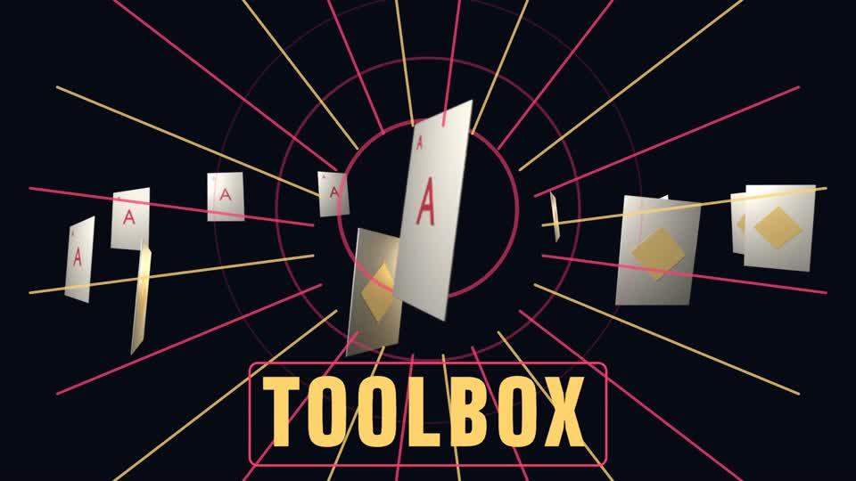

# _toolbox-demo

A 6-second test composition. It proves that the whole toolbox in `AGENTS.md` §4b works together
in this environment, deterministically:

- **three.js** draws a ring of 12 cards whose texture is the Blender atlas, each card with its own frame offset.
- **Canvas 2D** draws the big hero card (Blender atlas, `drawImage` sub-rect by frame index) and the beat rings.
- **SVG** draws the rays and the title frame.
- **anime.js** drives the SVG: a paused timeline, primed, then seeked to `t * 1000` from `DEMO.renderAt(t)`.
- **Blender** made `assets/blender/card_atlas.png` with `tools/blender/card_spin.py`, through
  `tools/blender_run.sh` and `tools/sprite_atlas.py`.

Checks: `hyperframes lint` 0/0, `validate --no-contrast` with no console errors. Renders with
`-w 1` and `-w 6` match (SSIM 0.9998). A render takes about 15 s.

